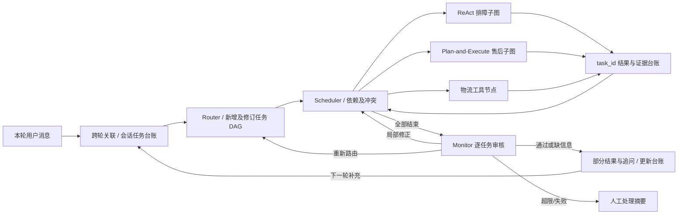

# DevMultiAgent

面向电商售后的多 Agent 工作流，基于 LangGraph 实现 Router → 动态任务调度 → Solver → Monitor。
支持技术排障、售后资格/政策咨询、订单与物流查询。项目为**可运行的本地工程演示**，不代表已接入真实电商生产系统。

## 已实现的能力

- **任务拆分与依赖编排**：规则预切分 + LLM 结构化识别，提取原文、实体、置信度、task_id、depends_on；Pydantic 校验协议及 DAG。无模型密钥或模型异常时使用确定性兜底。
- **动态并行**：通过 LangGraph Send 分发就绪任务，按依赖及读写资源冲突决定执行顺序。同一 Solver 的独立查询也能并行，不同 Solver 也可能串行。
- **三类执行模块**：技术排障为受预算限制的 ReAct 循环子图；售后为受约束的 Plan-and-Execute 子图；物流为只读工具节点，不调用模型规划。
- **共享状态与修正**：task_id 局部回写及冲突检测；结构化前置结果复用；Monitor 逐任务审核，内容修正使下游结果失效，路由问题返回 Router 重规划；最多两次修正后生成人工处理摘要。
- **跨轮业务任务**：会话级 `task_ledger` 保留目标、状态、缺失字段、追问 ID、修订版本及已审核结果；新消息可补充、修改、取消旧咨询，同时追加新请求。关联不明确时追问，不猜测订单归属；仅恢复受影响的任务及其下游。
- **有界会话上下文**：模型输入使用相关任务信息与有限历史摘要，默认保留最近 8 条消息、64 条最近任务、50 条归档概要；未完成任务不被裁剪。历史摘要为确定性文本压缩，不声称实现了 LLM 语义总结。
- **RAG 与证据**：Markdown 标题切片、长段落切分；原始 Query 与扩展 Query 双路召回，BM25 + 词项覆盖率（0.72/0.28）和 RRF 排名融合，获取 Top-5 证据。Monitor 复用 Solver 的完整证据及工具事实。
- **暂停恢复**：CLI 使用 SQLite 检查点；支持执行前确认、售后缺订单信息时中断，使用相同 thread_id 跨进程恢复。
- **功能测试**：离线运行，不依赖真实模型、不覆盖用户订单数据库；真实 API 测试需显式开启。



具体子图、状态协议、失效/复用规则：[架构说明](docs/architecture.md)。
简历中的功能和源码对应：[实现对照](docs/resume_alignment.md)。

## 安装与离线运行

需要 Python **3.12+**。Windows PowerShell：

```powershell
python -m venv .venv
.venv\Scripts\Activate.ps1
python -m pip install -e .
$env:DEVMA_OFFLINE = "1"
python data/seed_orders.py
```

seed_orders.py 是显式的演示数据初始化命令，可能覆盖相同 ID 的演示订单；不要对生产数据运行。
订单日期是固定演示日期，资格判断按运行时日期计算，时间流逝后退货窗口会变化。

交互会话：

```powershell
python interactive.py
# 使用此前打印的 thread_id 重新打开会话
python interactive.py --thread-id your-thread-id
```

单轮/多轮命令：

```powershell
devma chat "手机#1234到哪了？还有电脑#5678到哪了？" --verbose
devma chat "查手机#1234到哪了，然后看看能退吗？" --thread-id interview-demo
devma chat "我的手机多久到" --thread-id interview-demo
devma status interview-demo
```

同一 thread_id 保留业务任务台账；每轮 `tasks/task_results` 只是本轮执行视图，不清空跨轮未完成任务。
--verbose 只执行一次流程，不会重复调用模型或工具。

### 跨轮补充、插话与修正

不使用真实模型或用户数据库的完整演示（在仓库根目录运行）：`python -m examples.multi_turn_demo`。
演示在临时订单库和检查点库中运行，逐轮打印任务 ID、状态和修订版本；不会覆盖 `data/orders.db`。

```powershell
devma chat "手机#1234到哪了；耳机能退吗" --thread-id multi-turn-demo
# 已完成的物流结果先返回，耳机售后任务等待订单号
devma status multi-turn-demo
devma chat "订单号是12346，另外电脑#5678到哪了" --thread-id multi-turn-demo
# 售后沿用原 task_id，物流是新增任务；不重复执行第一轮手机查询
devma chat "电脑订单号说错了，订单号是1234" --thread-id multi-turn-demo
```

- “我想退款” → “为什么需要订单号” → “订单号是1234”：解释时保留原任务，补齐后继续执行。
- “我想退款；查物流” → “#1234”：多个等待任务均可能匹配时追问；可用 `devma status` 打印的任务 ID 或追问 ID 明确关联。
- “不退了”：取消**咨询任务**及依赖它的任务，不代表取消真实订单或退货申请。
- 排障后的“已经重启试过了，还是开不了机”：记录反馈，沿用任务 ID，避免机械重复已尝试的步骤。

每个咨询最多 6 次跨轮继续，再继续会进入人工核实状态；每次执行内仍最多两次 Monitor 修正。
结果带修订版本，订单/目标变化时失效对应任务及其下游；前置订单结果超过 180 秒时重新查询。
独立的全新物流请求总会重新查询，不把历史物流状态当作实时状态。

## 暂停与跨进程恢复

执行前确认：

```powershell
devma chat "手机#1234到哪了" --thread-id approval-demo --pause
# 可以关闭终端；恢复使用相同 thread_id
devma resume approval-demo --answer-file examples/approve_execution.json
```

售后缺订单信息时暂停：

```powershell
devma chat "我想退款" --thread-id order-demo --pause-on-missing-info
devma resume order-demo --answer-file examples/provide_order.json
```

默认缺信息会返回部分结果及澄清问题，并将业务任务记为 `waiting_user_input`；同一 thread_id 下一轮自然语言即可补充，不需要 `resume`。
`--pause-on-missing-info` 是额外的显式中断模式：启用后仍需 `resume`，该模式不允许暂停期间启动新的普通聊天轮次。
JSON 文件方式避免不同 shell 的引号转义问题。
如有多个并行中断，--answer 支持按返回的 interrupt_id 提供回答映射。
交互模式中使用 /resume JSON 继续未完成流程。

SQLite 文件：data/checkpoints.db；不会提交到 Git。
Python 调用中，build_graph() 默认内存检查点，持久化请使用 open_graph()：

```python
from langgraph.types import Command
from devma.orchestration.graph import open_graph

config = {"configurable": {"thread_id": "example"}, "recursion_limit": 60}
with open_graph() as graph:
    paused = graph.invoke({
        "messages": [{"role": "user", "content": "手机#1234到哪了"}],
        "pause_before_execution": True,
    }, config)
with open_graph() as graph:
    completed = graph.invoke(Command(resume={"approved": True}), config)
```

## 启用模型

复制 .env.example 为 .env，配置 DEEPSEEK_API_KEY，并关闭离线模式：

```powershell
Copy-Item .env.example .env
# 编辑 .env 填入自己的密钥；不要提交到仓库
$env:DEVMA_OFFLINE = "0"
python interactive.py
```

模型负责分类、受约束规划、回答生成与语义审核；代码负责协议、依赖、预算、资格规则和安全边界。
无模型模式不是完整 LLM 质量评估。模型审核超时或输出不合法会转人工，不能默认放行。
工具均为只读；真实退款、订单取消和实际客服分配尚未接入。

## 测试

```powershell
python -m pytest -q
# 明确允许付费 API 调用后才开启真实模型测试
python -m pytest --live -m live -q
```

默认测试使用临时演示订单库，覆盖依赖校验、同类任务并行、事实复用、失败传播、选择性修正、
修正上限、消息/任务隔离、证据复用、计划执行、检查点恢复与子图中断。
`tests/test_conversation.py` 覆盖跨轮补充、混合新请求、模糊关联、取消/修订、依赖解锁、排障反馈、
长对话、连接重建、修订版本校验、继续预算和交互/CLI 接入。
GitHub Actions 对 Python 3.12/3.13 执行离线测试。

## 项目结构

```text
devma/
├── agents/              # Router / Solver 封装 / Monitor
├── orchestration/
│   ├── contracts.py     # Pydantic 任务、计划、输出协议
│   ├── state.py         # AgentState 与 task_id reducer
│   ├── scheduler.py     # 依赖就绪/失败传播/结果失效
│   ├── conversation.py  # 跨轮关联、业务生命周期及有限摘要
│   ├── subgraphs.py     # ReAct 与 Plan-and-Execute 子图
│   └── graph.py         # 主图、SQLite 生命周期、脱敏 trace
├── tools/               # Markdown 检索、订单查询、资格判断
├── rules/               # 演示业务规则配置
└── evaluation/          # 原有离线检索评测入口
data/                    # 演示知识库与订单初始化
examples/                # 中断恢复的 JSON 输入
tests/                   # 默认离线功能测试
docs/                    # 架构、简历对应和历史设计/评测记录
```

## 能力边界

- 知识库和规则是演示口径，不应直接视为实际商家政策或法律意见。
- SQLite 保存内部业务状态；当前未实现账号鉴权、订单归属校验、多租户隔离、加密存储或真实客服系统。
- 不支持真实退款/取消写事务，因此不能声称已具备业务副作用的 exactly-once/幂等事务保障。
- 自然语言关联为规则优先、受代码校验的可选 LLM 补充，不保证任意复杂指代都可自动消歧。模糊订单/任务关系会追问。
- 同一 thread_id 必须串行提交；当前没有 HTTP 服务、分布式锁、请求幂等键、会话身份鉴权或自动超时取消机制。
- 检查点数据库会保留历史快照；活跃 State 的裁剪不等于数据库大小自动有界，部署前需要归档与保留期限策略。
- 上一版已有检查点的最后一批任务可在新消息到来时转换为会话台账；更早已被旧版清空的任务不会自动从全部历史快照重建。
- 本次仅完善功能，**未重测或更新简历中的延迟、Token、回答评分及违规/Monitor 实验数字**。
  docs/ 中历史实验记录不是本版自动验证的结果。
