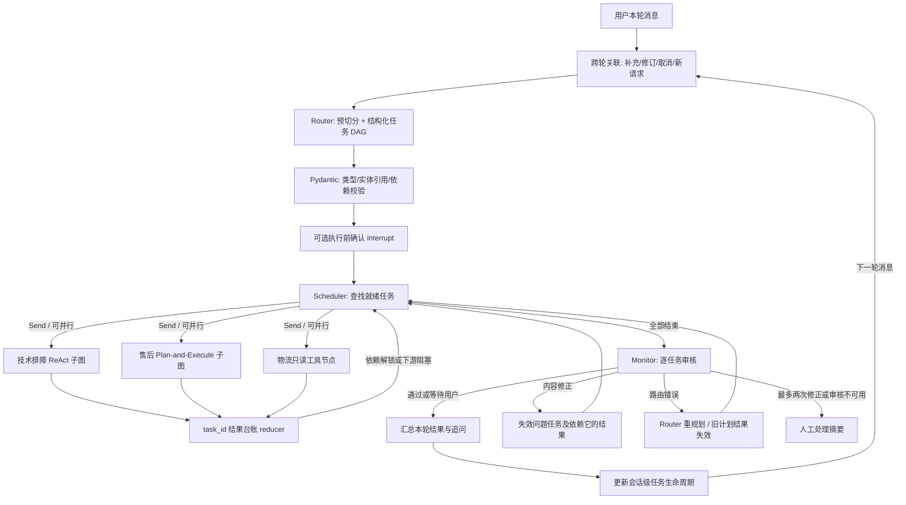

# DevMultiAgent 实现说明

## 总体执行链路



主图拓扑固定，Router 生成的是运行时任务 DAG，不是临时生成 Python 节点。
调度器用 LangGraph `Send` 分发就绪任务。不同 Solver 可能有依赖；同一 Solver 的独立只读任务也可以并行。
`execution_mode` 是对计划的概要描述，实际运行以 `depends_on` 和资源冲突为准。

### 示例

“查询手机 #1234 到哪了，然后看看能退吗；另外查电脑 #5678 的物流”：

- `t1`: 手机订单查询，无前置依赖。
- `t2`: 手机售后判断，依赖 `t1`，可复用它返回的结构化订单事实。
- `t3`: 电脑物流查询，无前置依赖。

第一批执行 `t1`、`t3`；`t1` 完成后执行 `t2`。前置任务需要补充信息或失败时，下游标记 `blocked`，不猜测前置结论。
当前采用同步批次调度：同批慢任务可能延迟下一批启动，并非流式的逐任务即时解锁调度器。

## 子图不等于固定业务链

技术排障子图：`prepare → think → action → think → respond → finish`。
模型根据观察选择检索、结束、提问或人工处理；重复查询与最大工具步数由代码约束。
无密钥时使用确定性决策，不将其声称为完整模型推理实验。只能检索排障知识，不能假装诊断/控制用户设备。

售后子图：`prepare → plan → execute → 检查 → execute/adjust/ask_user/respond`。
规划器可选择“政策检索 → 查订单 → 判断资格”或“查订单 → 政策检索 → 判断资格”，实际执行模型生成的合法计划。
一般政策问题可只检索，不强制要求订单。具体资格咨询必须查询订单，并在它之后运行代码资格判断。
非法动作、缺步骤、资格判断顺序错误的计划回退到安全计划；政策缺失只调整未完成的检索步骤。
这里是小动作集的受约束规划，不是允许任意工具、任意长度计划的通用规划器。

物流节点直接查订单并格式化结果，不再调用 LLM 规划或润色。
没有运单轨迹或预计送达字段时，不编造物流详情。

## 状态边界与并行写入

`AgentState.task_ledger` 是会话级业务生命周期的权威来源；`tasks/task_results` 是本轮需要调度的投影，不是第二份独立的完成状态。
每轮有独立 `request_id/turn_number`，业务任务的 `task_id` 跨轮不变。修改输入或目标时递增 `revision`，使旧结果及下游消费者失效。
`turn_task_ids` 标识本轮新增/修改的任务；已经完成的独立任务不再次执行或重复汇报。任务的待补充状态不是执行失败。
子图使用自己的 `SolverState`，只读取当前任务、显式前置结果和对应反馈；通过统一 `SolverOutput` 发布结果。

并行任务只写 `{task_id: result}`，由 reducer 合并；结果键与内部 `task_id` 不一致、同一任务出现冲突写入时拒绝更新。
这属于代码层通信约束，不是对恶意 Python 代码的安全沙箱。
订单事实只能在明确相同订单号的依赖任务之间复用，不能把其他商品的订单号复制过来。

内容修正：保留独立成功任务，移除问题任务及其所有下游消费者，再运行这些任务。
路由重规划：旧计划整体失效，生成新的任务 ID，避免拿旧结果混入新计划。
跨轮可复用同一 thread_id 内、输入版本一致且未过期的已审核前置结果；不支持跨用户/跨会话业务结果缓存。

## 跨轮对话管理

`conversation.prepare_turn` 先将本轮消息关联到旧任务，再把剩余新业务交给 Router。
每个任务保存 `status/revision/created_turn/updated_turn/missing_fields/question/clarification_id/followups`、当前结果与审核，以及有限旧结果概要。

生命周期：

```text
pending → completed / waiting_user_input / waiting_dependency / handoff
waiting_user_input → 用户补充与校验 → revision + 1 → pending
waiting_dependency → 前置结果可用 → pending → 执行
completed → 明确修订或排障反馈 → 失效相关结果 → pending
waiting/pending → 用户取消咨询 → cancelled（依赖消费者也取消）
```

- 默认业务等待不是 LangGraph 中断：当前 invocation 正常结束，返回已完成任务与追问，未完成任务由 SQLite 检查点保留。
- 用户回复可能同时补齐 T2 并创建 T4；关联歧义不改状态，返回任务 ID/商品消歧问题。
- task_id、revision、原文引用、订单号来源与取消意图在代码中校验；模型提出的补丁不能凭空创造订单号或修改别的会话任务。
- 多个订单号对应同一任务时追问。未知自然语言关联允许受约束的 LLM 补充，异常时退回确定性规则，不承诺任意指代都能正确理解。
- 原文 span 保存业务目标，followups 保存后续观察；子 Solver 读取相关补充，而不是整个会话的所有任务。
- 取消的是本地咨询任务；没有真实订单取消、退款支付或 CRM 调用。
- 6 次跨轮继续预算与每次执行内的 2 次审核修正预算分别控制不同循环。

活跃消息保留最近 8 条，更早消息转为最多 4000 字符的确定性概要；最近任务台账最多 64 条，终态任务裁剪后保留最多 50 条归档概要。
未完成任务不会因消息裁剪被删除；同时未完成任务与所需前置闭包最多 12 个，超限拒绝创建新增任务。
完整旧状态仍可能存在 SQLite 检查点，活跃状态有界不代表历史数据库自动有界；未实现数据库归档/保留期限。
订单事实作为前置缓存最多复用 180 秒；明确新物流查询始终查工具。当前是时间预算而非真实商家事件驱动失效。

## RAG 与审核

离线索引：Markdown 标题分段 → 长段优先按段落继续切分（最多 1200 字符，120 字符重叠）→ 保存来源、标题层级、片段 ID 和内容哈希。
字符预算不是模型 token 预算；复杂表格/代码块的结构化切分仍可进一步扩展。

在线检索：保留原始 Query → 结合上下文做轻量词项扩展 → 原始/扩展双路检索 → 片段 ID 去重与 RRF 融合 → Top-5 证据。
每一路使用 `0.72 × BM25 + 0.28 × 词项覆盖率`。词项覆盖率是词法特征，不是 embedding 语义相似度；权重是配置基线，不是本次验证得到的最优参数。
RRF 是双路结果排名融合，不是独立 Cross-Encoder 重排。

技术与售后 Solver 使用 RAG，物流默认只用订单工具。Solver 保存完整证据和工具事实，Monitor 逐任务复用对应证据，不用模型答案作为检索 Query 来证明答案自身。
审核依次检查硬规则、人工接管条件、未经授权承诺、事实与资格结果冲突；启用模型时再做语义承诺与依据审核。
订单存在不能证明任意退款承诺或预计到达时间。模型审核失败时转人工，不默认放行。
离线模式只运行确定性审核，不能等同于已经通过模型语义审核。否定句与后续肯定承诺按子句分别检查，但规则仍不是完整自然语言理解。

## 暂停恢复与人工处理

`build_graph()` 默认内存检查点，适合单元测试。
`open_graph(db_path)` 管理 SQLite 检查点连接，CLI 和交互会话使用它。
同一 `thread_id` + `Command(resume=...)` 可跨进程恢复。执行前确认、售后缺订单信息均有真实 `interrupt()`。
子图继承父图检查点，内部步骤和暂停位置可恢复；包装节点的恢复会重新进入节点，不能随意在 `interrupt()` 前加入非幂等副作用。

当前业务工具全为只读：真实订单取消/退款支付均未接入。
`handoff_needed` 和 `handoff_context` 是人工工单的集成接口，不表示已调用真实 CRM 或客服分配系统。
SQLite 存储原始内部业务状态，只适合本地演示；生产需要身份校验、订单归属检查、存储保护和持久化服务。
同一会话不可由多个请求同时写入；未来 API 层应做会话级串行化。
普通跨轮等待与显式 interrupt 是两个模式；当前 CLI 在显式中断期间仍要求先 resume，不能同时接收普通新请求。

## 官方机制参考

- [LangGraph Graph API / Send / reducers](https://docs.langchain.com/oss/python/langgraph/graph-api)
- [子图与父图检查点继承](https://docs.langchain.com/oss/python/langgraph/use-subgraphs)
- [interrupt 和 Command 恢复](https://docs.langchain.com/oss/python/langgraph/interrupts)
- [检查点后端](https://reference.langchain.com/python/langgraph/checkpoints)

## 本次范围

本版完善功能和功能测试，未重跑性能、回答评分、100 条违规样本或 50 条 Monitor 实验。
运行面板的 `solver_tokens` 目前只含回答生成调用的 Token，不含 Router、规划及 Monitor 调用，不能作为端到端 Token 成本。
历史评测文档不应自动视为本版成果；上线量、真实用户数、性能改进和误拦/漏检数字需要另外采集验证。
